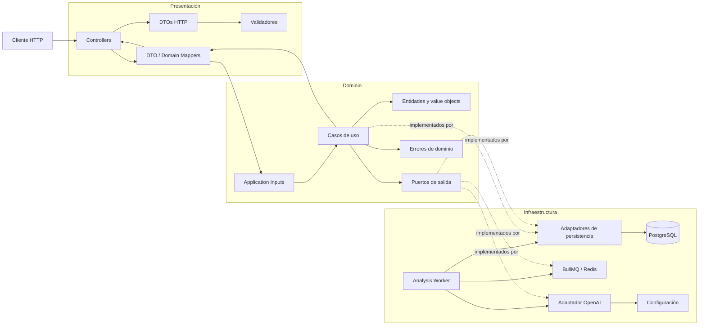
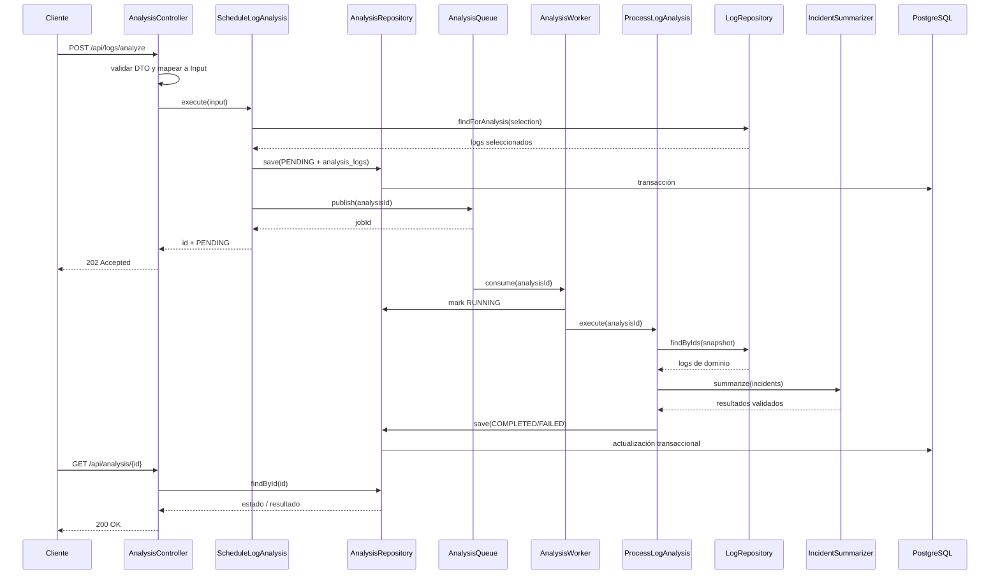

# Arquitectura — SmartLog Analyzer

## 1. Objetivo

SmartLog Analyzer recibe logs de distintos microservicios, los persiste y permite analizar un conjunto de ellos para obtener:

- un resumen en lenguaje natural;
- una categorización de los problemas detectados;
- sugerencias de acción.

La solución se diseña con **arquitectura hexagonal** (Ports and Adapters), separando tres capas principales:

1. **Presentación**: protocolo HTTP y transformación de datos externos.
2. **Dominio**: reglas de negocio, casos de uso y puertos.
3. **Infraestructura**: persistencia, OpenAI y detalles técnicos.

La regla principal es que las dependencias apuntan hacia el dominio. El dominio no depende de NestJS, Prisma, PostgreSQL, OpenAI ni de objetos HTTP.

## 2. Diagrama general



## 3. Dependencias y límites

### Presentación

Responsabilidades:

- exponer los endpoints REST;
- recibir y validar DTOs;
- mapear DTOs a inputs de aplicación;
- mapear resultados del dominio a respuestas HTTP;
- traducir errores de aplicación a códigos HTTP.

Esta capa **no contiene reglas de negocio**.

Ejemplo de flujo:

```text
POST /api/logs
  HTTP request
    -> CreateLogDto
    -> CreateLogInput
    -> CreateLogUseCase.execute(input)
    -> CreateLogOutput
    -> LogResponseDto
    -> HTTP response
```

Los DTOs pertenecen exclusivamente a Presentación. Los casos de uso reciben sus propios `Input` y devuelven sus propios `Output`; nunca reciben `CreateLogDto`, `Request`, `Response` ni clases de NestJS.

### Dominio

Responsabilidades:

- representar conceptos del negocio (`Log`, `Analysis`, `LogLevel`);
- coordinar casos de uso;
- aplicar reglas de negocio;
- definir interfaces de puertos de salida;
- definir contratos de inputs y outputs de aplicación;
- expresar errores esperables del negocio.

El Dominio no importa clases de Infraestructura ni de Presentación.

### Infraestructura

Responsabilidades:

- implementar repositorios definidos por el dominio;
- convertir modelos de persistencia a entidades de dominio y viceversa;
- ejecutar migraciones y consultas SQL/Prisma;
- implementar el cliente de OpenAI;
- publicar y consumir trabajos mediante BullMQ/Redis;
- ejecutar el worker que procesa análisis en segundo plano;
- leer configuración y secretos desde variables de entorno;
- construir la aplicación y conectar adaptadores con sus puertos.

## 4. Estructura propuesta

```text
src/
├── main.ts
├── app.module.ts
├── presentation/
│   ├── http/
│   │   ├── logs/
│   │   │   ├── logs.controller.ts
│   │   │   ├── dto/
│   │   │   └── mappers/
│   │   ├── analysis/
│   │   │   ├── analysis.controller.ts
│   │   │   ├── dto/
│   │   │   └── mappers/
│   │   └── health/
│   ├── filters/
│   └── pipes/
├── domain/
│   ├── logs/
│   │   ├── entities/
│   │   ├── inputs/
│   │   ├── outputs/
│   │   ├── ports/
│   │   └── use-cases/
│   ├── analysis/
│   │   ├── entities/
│   │   ├── inputs/
│   │   ├── outputs/
│   │   ├── ports/
│   │   └── use-cases/
│   └── shared/
│       ├── errors/
│       └── types/
└── infrastructure/
    ├── persistence/
    │   ├── prisma/
    │   ├── repositories/
    │   └── mappers/
    ├── llm/
    │   ├── openai/
    │   ├── prompts/
    │   └── parsers/
    ├── queue/
    │   ├── bullmq/
    │   ├── analysis.worker.ts
    │   └── analysis.queue.ts
    └── config/
```

El worker podrá ejecutarse como un proceso separado de la API usando el mismo código de dominio e infraestructura. En desarrollo puede convivir en el mismo contenedor/proceso, pero la separación lógica debe mantenerse.

Los nombres pueden cambiar durante la implementación, pero la separación de responsabilidades se mantiene.

## 5. Casos de uso iniciales

| Caso de uso | Responsabilidad | Puerto requerido |
|---|---|---|
| `CreateLog` | Validar reglas de negocio y guardar un log | `LogRepository` |
| `ListLogs` | Buscar logs aplicando filtros y paginación | `LogRepository` |
| `ScheduleLogAnalysis` | Validar la selección, crear el análisis y publicar un trabajo | `LogRepository`, `AnalysisRepository`, `AnalysisQueue` |
| `ProcessLogAnalysis` | Ejecutar el pipeline, invocar IA y guardar el resultado | `LogRepository`, `AnalysisRepository`, `IncidentSummarizer` |
| `GetAnalysis` | Recuperar un análisis persistido | `AnalysisRepository` |
| `CheckHealth` | Verificar disponibilidad de dependencias | `HealthCheckPort` |

Los casos de uso orquestan el flujo; los detalles de PostgreSQL, Redis, BullMQ y OpenAI quedan detrás de puertos.

## 6. Patrón para la integración con LLM

### Decisión propuesta

Usaremos un puerto de salida definido en el dominio:

```typescript
export interface LogAnalysisPort {
  analyze(input: LogAnalysisInput): Promise<LogAnalysisResult>;
}
```

`ProcessLogAnalysis` depende de `LogAnalysisPort`, no de OpenAI:

```text
ProcessLogAnalysisUseCase
  -> LogRepository.findByIds(...)
  -> LogAnalysisPort.analyze(logs)
  -> AnalysisRepository.save(result)
```

En Infraestructura habrá un adaptador:

```text
OpenAiLogAnalysisAdapter implements LogAnalysisPort
```

### Por qué este patrón

Es una combinación de **Hexagonal Architecture + Dependency Inversion + Anti-Corruption Layer**:

- el SDK y los tipos de OpenAI no se filtran al dominio;
- el prompt queda encapsulado en el adaptador;
- la respuesta externa se transforma y valida antes de convertirse en un resultado del dominio;
- los tests del caso de uso pueden usar un `FakeLogAnalysisAdapter` sin hacer llamadas de red;
- mañana se podría agregar `AnthropicLogAnalysisAdapter`, `GeminiLogAnalysisAdapter` o un modelo local sin cambiar `ProcessLogAnalysisUseCase`.

No se propone un patrón `Strategy` adicional en esta primera versión: el puerto ya permite reemplazar el proveedor y agregar una selección por configuración si fuera necesario.

### Contrato interno de resultado

El adaptador debe devolver una estructura controlada por nuestra aplicación, por ejemplo:

```typescript
type LogAnalysisResult = {
  summary: string;
  categories: Array<{
    name: string;
    severity: 'low' | 'medium' | 'high' | 'critical';
    evidence: string[];
  }>;
  suggestions: string[];
  provider: string;
  model: string;
};
```

El formato de OpenAI no se persiste directamente. El adaptador debe:

1. construir el prompt a partir de logs normalizados;
2. solicitar una respuesta estructurada en JSON;
3. aplicar un timeout;
4. parsear la respuesta;
5. validar campos, tipos y valores permitidos;
6. devolver un error técnico controlado si el formato no es válido.

La validación del resultado del LLM es necesaria porque una respuesta HTTP exitosa del proveedor no garantiza que el contenido cumpla nuestro contrato.

### Errores esperados del LLM

Se modelarán como errores técnicos de aplicación, sin exponer detalles ni API keys:

- `LlmTimeoutError`: OpenAI excedió el tiempo permitido;
- `LlmUnavailableError`: proveedor inaccesible o error de red;
- `LlmInvalidResponseError`: respuesta válida HTTP pero formato inesperado;
- `LlmConfigurationError`: falta configuración necesaria.

El worker marcará el análisis como `FAILED` si el pipeline no puede completarse. No se guardará un análisis parcial como si fuera exitoso. BullMQ permitirá configurar reintentos para fallos transitorios; los errores de formato del LLM deben terminar como fallo definitivo y no reintentarse indefinidamente.

### Uso de OpenAI

La implementación concreta usará la API de OpenAI mediante variables de entorno, sin valores reales en el repositorio:

```text
OPENAI_API_KEY=
OPENAI_MODEL=
OPENAI_TIMEOUT_MS=
```

La clave se leerá únicamente en Infraestructura. Nunca debe aparecer en DTOs, logs, respuestas HTTP, seeds ni commits.

## 6.1 Pipeline de análisis de logs

El análisis completo se modela como un pipeline ejecutado por `ProcessLogAnalysisUseCase` dentro de un worker:

```text
ParseLog
   ↓
DetectAnomalies
   ↓
ClusterIncidents
   ↓
SummarizeIncidents (LLM)
   ↓
SaveReports
```

### Responsabilidad de cada etapa

| Etapa | Responsabilidad | ¿Usa LLM? |
|---|---|---|
| `ParseLog` | Convertir una entrada cruda a un `LogEntry` normalizado | No |
| `DetectAnomalies` | Encontrar logs o comportamientos anómalos mediante reglas deterministas | No |
| `ClusterIncidents` | Agrupar anomalías relacionadas en incidentes | No, inicialmente |
| `SummarizeIncidents` | Explicar cada incidente y proponer acciones | Sí |
| `SaveReports` | Persistir los reportes generados y su trazabilidad | No |

La decisión de mantener las primeras etapas fuera del LLM tiene varios beneficios: el comportamiento es determinista y testeable, reduce costos y tokens, y permite explicar por qué un log fue considerado anómalo. El LLM se utiliza donde aporta más valor: interpretación, resumen y sugerencias.

### Detección de anomalías basada en reglas

La primera versión utilizará un `RuleBasedAnomalyDetector`. Cada anomalía conserva la regla que la originó y la evidencia utilizada, para que el análisis sea explicable:

```typescript
type Anomaly = {
  logIds: string[];
  type: 'error-level' | 'repeated-message' | 'error-spike' | 'known-pattern';
  reason: string;
  evidence: Record<string, unknown>;
  severity: 'low' | 'medium' | 'high' | 'critical';
};
```

Reglas iniciales propuestas:

1. **Error crítico**: un log con nivel `ERROR` y un patrón crítico conocido genera una anomalía inmediata.
2. **Error explícito**: un log con nivel `ERROR` genera una anomalía con la evidencia del mensaje y servicio.
3. **Repetición de mensaje**: el mismo mensaje se repite más de un umbral dentro de una ventana temporal.
4. **Pico de errores**: un servicio supera un umbral de errores dentro de una ventana temporal.
5. **Patrón conocido**: el mensaje coincide con expresiones configuradas, como `timeout`, `connection refused` u `out of memory`.

Las reglas serán pequeñas, independientes y testeables. Los umbrales no deben quedar hardcodeados en el controller.

```typescript
interface AnomalyRule {
  evaluate(logs: LogEntry[]): Anomaly[];
}

class RuleBasedAnomalyDetector implements AnomalyDetector {
  constructor(private readonly rules: AnomalyRule[]) {}

  async detect(logs: LogEntry[]): Promise<Anomaly[]> {
    return this.rules.flatMap((rule) => rule.evaluate(logs));
  }
}
```

En una iteración posterior se podrán agregar reglas estadísticas o un detector basado en ML sin modificar `ProcessLogAnalysisUseCase`, porque ambos implementarán el mismo puerto `AnomalyDetector`.

### `ParseLog` es una etapa condicional

Si `POST /api/logs` recibe un objeto ya estructurado, por ejemplo `timestamp`, `service`, `level` y `message`, el parser no es necesario para ese flujo. Puede utilizarse posteriormente para soportar:

- líneas de texto;
- JSON emitido por distintos servicios;
- formatos comunes como syslog;
- archivos de logs.

En ese caso, el parser debe devolver un resultado controlado o un error de formato; no debe generar entidades parcialmente inválidas.

### Contratos de los puertos

Los contratos pertenecen al Dominio o a la capa de aplicación, no a Infraestructura:

```typescript
interface LogParser {
  parse(input: RawLogInput): ParsedLog;
}

interface AnomalyDetector {
  detect(logs: LogEntry[]): Promise<Anomaly[]>;
}

interface IncidentClusterer {
  cluster(anomalies: Anomaly[]): Promise<Incident[]>;
}

interface IncidentSummarizer {
  summarize(incident: Incident): Promise<IncidentSummary>;
}

interface AnalysisRepository {
  createPending(input: AnalysisInput): Promise<Analysis>;
  markRunning(id: string): Promise<void>;
  complete(id: string, result: AnalysisResult): Promise<Analysis>;
  fail(id: string, errorCode: string): Promise<Analysis>;
  findById(id: string): Promise<Analysis | null>;
}

interface AnalysisQueue {
  publish(input: { analysisId: string }): Promise<{ jobId: string }>;
}
```

`IncidentSummarizer` es el único puerto que inicialmente implementará OpenAI. La detección de anomalías seguirá siendo basada en reglas y no dependerá de OpenAI. El nombre expresa la capacidad del dominio y evita que el caso de uso dependa de una marca o SDK específico. Si en el futuro se necesita una segunda capacidad de IA —por ejemplo, clasificación— se agrega otro puerto explícito en lugar de crear un `LLMProvider` genérico con demasiadas responsabilidades.

### Orquestadores y worker

`ScheduleLogAnalysisUseCase` valida la selección, crea el análisis en estado `PENDING` y publica únicamente el `analysisId`. No ejecuta OpenAI ni las reglas.

`ProcessLogAnalysisUseCase`, ejecutado por el worker, coordina el pipeline, pero no conoce cómo se detecta, agrupa, resume o persiste:

```typescript
export class ProcessLogAnalysisUseCase {
  constructor(
    private readonly detector: AnomalyDetector,
    private readonly clusterer: IncidentClusterer,
    private readonly summarizer: IncidentSummarizer,
    private readonly repository: AnalysisRepository,
  ) {}

  async execute(analysisId: string): Promise<void> {
    const logs = await this.logRepository.findByAnalysisId(analysisId);
    await this.analysisRepository.markRunning(analysisId);
    const anomalies = await this.detector.detect(logs);
    const incidents = await this.clusterer.cluster(anomalies);

    const reports: IncidentReport[] = [];

    for (const incident of incidents) {
      const summary = await this.summarizer.summarize(incident);
      reports.push({ incident, summary });
    }

    const result = AnalysisResult.create({
      sourceLogIds: logs.map((log) => log.id),
      incidents: reports,
    });

    await this.analysisRepository.complete(analysisId, result);
  }
}
```

Este código es deliberadamente independiente de NestJS. La inyección mediante `@Inject(ANOMALY_DETECTOR)` y los tokens de Nest se configura en el módulo de composición de Infraestructura:

```text
Infrastructure module
  ANOMALY_DETECTOR    -> RuleBasedAnomalyDetector
  INCIDENT_CLUSTERER   -> TimeAndServiceIncidentClusterer
  INCIDENT_SUMMARIZER  -> OpenAiIncidentSummarizer
  ANALYSIS_REPOSITORY  -> PrismaAnalysisRepository
```

Así, los tests pueden construir los casos de uso con fakes directamente, sin levantar NestJS ni Redis.

### ¿Secuencial o paralelo?

La detección y la agrupación son secuenciales porque cada etapa depende del resultado de la anterior. Los resúmenes de incidentes son independientes entre sí y podrían ejecutarse en paralelo, pero no se recomienda un `Promise.all` sin límite porque puede generar muchas llamadas simultáneas a OpenAI.

La primera implementación puede ser secuencial por simplicidad. Como mejora, se puede agregar concurrencia limitada —por ejemplo, dos o tres incidentes simultáneos— con una política explícita de rate limiting.

### Política de errores del pipeline

- Si el parseo falla, no se crea un análisis.
- Si no se detectan anomalías, se persiste un reporte exitoso con cero incidentes, si ese comportamiento resulta útil para auditoría.
- Si falla la detección o agrupación, el análisis falla sin guardar un reporte incompleto.
- Si falla el resumen de un incidente, la primera versión falla el análisis completo para evitar reportes engañosos.
- Como mejora, se pueden guardar estados `pending`, `completed` y `failed`, permitiendo reintentar solo los incidentes fallidos.

La política definitiva debe quedar reflejada en los tests y en el contrato de la API.

## 7. Modelo de datos

El modelo inicial tendrá dos entidades principales y una tabla de unión:

```text
logs 1 ─────────── N analysis_logs N ─────────── 1 analyses
```

Un registro de `analyses` representa una **ejecución de análisis**, no necesariamente un incidente. Una ejecución puede encontrar cero, uno o varios incidentes. Los incidentes y hallazgos se almacenan dentro de `analyses.result` como resultado estructurado.

### Tabla `logs`

| Campo | Tipo PostgreSQL | Restricciones / propósito |
|---|---|---|
| `id` | `UUID` | PK. Identificador del log. |
| `service` | `VARCHAR` | NOT NULL. Microservicio de origen. |
| `level` | `VARCHAR` | NOT NULL. `ERROR`, `WARN`, `INFO`, `DEBUG`. |
| `message` | `TEXT` | NOT NULL. Mensaje del log. |
| `timestamp` | `TIMESTAMPTZ` | NOT NULL. Momento en que ocurrió el evento. |
| `received_at` | `TIMESTAMPTZ` | NOT NULL. Momento en que SmartLog recibió el log. |
| `trace_id` | `VARCHAR` | NULL. Correlación entre servicios. |
| `metadata` | `JSONB` | NOT NULL, default `{}`. Datos variables adicionales. |

Se conservan `timestamp` y `received_at` porque representan momentos diferentes. Un log puede generarse a las 10:00 y recibirse a las 10:02; esa diferencia permite detectar retrasos de ingesta y distinguir problemas del sistema observado de problemas del pipeline de recepción.

Índices iniciales recomendados:

- `(service, timestamp)` para filtros por servicio y rango temporal;
- `(level, timestamp)` para búsquedas de errores y advertencias;
- `(received_at)` para analizar retrasos de ingesta;
- `(trace_id)` cuando el valor no sea nulo.

### Tabla `analyses`

Representa una ejecución completa o fallida del pipeline de análisis.

| Campo | Tipo PostgreSQL | Restricciones / propósito |
|---|---|---|
| `id` | `UUID` | PK. Identificador de la ejecución. |
| `status` | `VARCHAR` | NOT NULL. `PENDING`, `RUNNING`, `COMPLETED`, `FAILED`. |
| `created_at` | `TIMESTAMPTZ` | NOT NULL. Momento de solicitud. |
| `completed_at` | `TIMESTAMPTZ` | NULL. Momento de finalización, éxito o fallo. |
| `filters` | `JSONB` | NOT NULL, default `{}`. Filtros usados para seleccionar los logs. |
| `model` | `VARCHAR` | NULL si no se llegó a invocar un modelo. Modelo LLM utilizado. |
| `summary` | `TEXT` | NULL hasta completar. Resumen generado. |
| `result` | `JSONB` | NULL hasta completar. Hallazgos estructurados. |
| `error_code` | `VARCHAR` | NULL. Código técnico controlado si falla. |

Reglas de consistencia:

- `completed_at` debe estar definido cuando `status` sea `COMPLETED` o `FAILED`.
- `summary` y `result` deben estar definidos cuando `status` sea `COMPLETED`.
- `error_code` debe estar definido cuando `status` sea `FAILED`.
- El mensaje sensible del error no se persiste ni se devuelve; se usa `error_code` para exponer una causa segura y el detalle queda en logs técnicos.
- `model` puede ser nulo si el análisis falla antes de llamar al LLM.

Ejemplo de `result`:

```json
{
  "anomalies": [
    {
      "type": "error-spike",
      "severity": "high",
      "service": "payments",
      "evidence": {
        "errorCount": 18,
        "windowMinutes": 5,
        "rule": "error-spike"
      }
    }
  ],
  "incidents": [
    {
      "id": "incident-1",
      "severity": "high",
      "logIds": ["..."],
      "category": "availability",
      "summary": "Aumento de errores de conexión con el proveedor de pagos.",
      "recommendations": ["Verificar disponibilidad del proveedor externo."]
    }
  ],
  "recommendations": [
    "Revisar timeouts y circuit breaker del servicio payments."
  ]
}
```

El contrato exacto de `result` se definirá en el dominio y se validará antes de persistir la respuesta de OpenAI. `JSONB` permite evolucionar el formato sin agregar columnas para cada nuevo hallazgo, mientras que el contrato de aplicación mantiene la estructura conocida por el código.

### Tabla `analysis_logs`

Tabla de unión entre una ejecución y los logs que efectivamente fueron analizados:

| Campo | Tipo PostgreSQL | Propósito |
|---|---|---|
| `analysis_id` | `UUID` | FK a `analyses.id`. |
| `log_id` | `UUID` | FK a `logs.id`. |
| `created_at` | `TIMESTAMPTZ` | Momento en que se creó la relación. |

La PK será compuesta por (`analysis_id`, `log_id`). Las FKs usarán `ON DELETE CASCADE` desde `analyses` y `ON DELETE RESTRICT` desde `logs`, para evitar perder logs que sirven como evidencia histórica. La tabla funciona como un snapshot de los logs analizados: `filters` explica cómo se seleccionaron y `analysis_logs` registra cuáles fueron seleccionados realmente.

### Ciclo de vida de un análisis

```text
PENDING → RUNNING → COMPLETED
                  ↘ FAILED
```

Aunque el primer endpoint pueda responder de forma síncrona, se conserva el estado porque el pipeline incluye varias etapas y puede evolucionar a procesamiento asíncrono sin rediseñar el modelo.

## 8. Persistencia y puertos

Puertos principales definidos por el dominio:

```typescript
interface LogRepository {
  save(log: Log): Promise<Log>;
  findById(id: string): Promise<Log | null>;
  findMany(filter: LogFilter): Promise<Paginated<Log>>;
  findByIds(ids: string[]): Promise<Log[]>;
  findForAnalysis(selection: AnalysisSelection): Promise<Log[]>;
}

interface AnalysisRepository {
  createPending(input: CreateAnalysisInput): Promise<Analysis>;
  markRunning(id: string): Promise<void>;
  complete(id: string, result: AnalysisResult): Promise<Analysis>;
  fail(id: string, errorCode: string): Promise<Analysis>;
  findById(id: string): Promise<Analysis | null>;
}

interface AnalysisQueue {
  publish(input: { analysisId: string }): Promise<{ jobId: string }>;
}
```

Los adaptadores Prisma implementarán estos contratos. Las entidades de dominio no serán las mismas clases que los modelos Prisma.

## 9. Flujo principal de análisis



### Contrato HTTP asíncrono

`POST /api/logs/analyze` no devuelve el reporte completo. Luego de validar la selección y persistir la ejecución, responde:

```http
202 Accepted
```

```json
{
  "id": "analysis-uuid",
  "status": "PENDING",
  "message": "Analysis scheduled"
}
```

`GET /api/analysis/{id}` devuelve el estado actual:

```json
{
  "id": "analysis-uuid",
  "status": "RUNNING",
  "createdAt": "2026-11-03T12:00:00.000Z",
  "completedAt": null,
  "result": null
}
```

Cuando termina, `status` será `COMPLETED` y `result` contendrá anomalías, incidentes y recomendaciones. Si el worker falla definitivamente, será `FAILED` con un `errorCode` seguro.

## 10. Decisiones tomadas y alternativas descartadas

### Arquitectura hexagonal

- **Elegida:** Presentación, Dominio e Infraestructura con puertos y adaptadores.
- **Descartada:** arquitectura por tipo técnico (`controllers/`, `services/`, `repositories/`) sin límites explícitos.
- **Motivo:** la separación hexagonal protege las reglas de negocio de cambios de framework, base de datos o proveedor de IA y facilita las pruebas.

### OpenAI detrás de un puerto

- **Elegida:** `LogAnalysisPort` + `OpenAiLogAnalysisAdapter`.
- **Descartada:** invocar el SDK de OpenAI directamente desde un servicio o controller.
- **Motivo:** evita acoplamiento, permite mocks/fakes y centraliza prompt, timeout, parseo y validación.

### Detección de anomalías

- **Elegida:** reglas deterministas ejecutadas por `RuleBasedAnomalyDetector`.
- **Alternativa descartada inicialmente:** pedirle al LLM que detecte todas las anomalías.
- **Motivo:** las reglas son más económicas, reproducibles, auditables y fáciles de probar. También permiten conservar evidencia concreta de cada anomalía. OpenAI se reserva para resumir incidentes y sugerir acciones, donde el lenguaje natural aporta más valor.

### Procesamiento asíncrono

- **Elegido:** `POST /api/logs/analyze` valida, crea una ejecución `PENDING`, publica un job en BullMQ y responde `202 Accepted` con el `analysisId`.
- **Alternativa descartada:** esperar el resultado completo del pipeline en la misma request.
- **Motivo:** el análisis puede involucrar llamadas lentas al LLM y no debe mantener conexiones HTTP abiertas. El worker permite controlar concurrencia, reintentos y escalabilidad independientemente de la API.

### Cola de trabajos

- **Elegida:** BullMQ sobre Redis.
- **Alternativas descartadas:** RabbitMQ y procesamiento en memoria.
- **Motivo:** BullMQ cubre retries, backoff, estados y concurrencia con una infraestructura menor que RabbitMQ. El procesamiento en memoria no es durable y se perdería al reiniciar la aplicación.

### Consistencia entre base de datos y cola

- **Elegida para el MVP:** persistir `analyses` y `analysis_logs` en una transacción, y publicar el `analysisId` después del commit.
- **Riesgo conocido:** si la aplicación se cae después del commit y antes de publicar, el análisis podría quedar en `PENDING`.
- **Mitigación inicial:** un job periódico que detecte ejecuciones `PENDING` sin job y las reprograme.
- **Mejora futura:** patrón Outbox transaccional para garantizar la publicación.

### PostgreSQL

- **Elegido:** PostgreSQL.
- **Alternativas descartadas:** SQLite y MongoDB.
- **Motivo:** se necesitan relaciones entre análisis y logs, integridad referencial y agregaciones por servicio, nivel y fecha.

### Tabla de unión para los logs analizados

- **Elegida:** `analysis_logs` con PK compuesta y FKs a `analyses` y `logs`.
- **Alternativa descartada:** guardar únicamente los filtros en `analyses` y volver a consultar los logs cada vez.
- **Motivo:** los filtros no identifican necesariamente el conjunto exacto después de que ingresan nuevos logs. La tabla de unión conserva la trazabilidad y reproducibilidad de cada ejecución.

### Resultado flexible del análisis

- **Elegido:** `result JSONB` con un contrato estructurado definido por la aplicación.
- **Alternativa descartada:** crear una tabla por cada tipo de hallazgo.
- **Motivo:** el resultado de un LLM puede evolucionar y contiene estructuras anidadas. JSONB permite flexibilidad sin abandonar validación, porque el resultado se valida antes de persistir.

### Prisma como adaptador de persistencia

- **Elegido:** Prisma dentro de Infraestructura.
- **Alternativa descartada:** exponer Prisma directamente en los casos de uso.
- **Motivo:** Prisma ofrece tipado y migraciones, pero no debe definir el modelo de negocio ni contaminar el dominio.

## 11. Decisiones cerradas para el MVP

La arquitectura queda suficientemente definida para comenzar la implementación. Se adoptan estas decisiones:

1. **Entrada de logs:** la API recibe logs estructurados con `service`, `level`, `message` y `timestamp`; `metadata`, `trace_id` y `received_at` son soportados por el modelo.
2. **Niveles:** `ERROR`, `WARN`, `INFO` y `DEBUG`.
3. **Identificadores:** UUID generados por la aplicación.
4. **Selección para análisis:** se aceptan `logIds` y filtros opcionales. Si se envían ambos, los logs deben cumplir ambos criterios.
5. **Límite:** máximo de 100 logs por análisis.
6. **Detección:** reglas deterministas configuradas en código inicialmente.
7. **Agrupación:** por servicio, patrón de error y ventana temporal.
8. **Ejecución:** asíncrona mediante BullMQ y Redis.
9. **OpenAI:** se utiliza para resumir incidentes y generar recomendaciones; el modelo se configura mediante variable de entorno.
10. **Timeout:** 20 segundos para la llamada al proveedor.
11. **Reintentos:** BullMQ tendrá reintentos limitados para fallos transitorios, con backoff; los errores de formato del LLM serán fallos definitivos.
12. **Respuesta inválida del LLM:** el análisis falla con un error controlado.
13. **Persistencia:** los logs son inmutables y `analysis_logs` conserva el conjunto exacto analizado.
14. **Resultado:** `analyses.result` contiene un JSONB estructurado y validado antes de persistirse.
15. **Privacidad:** se redactarán tokens, emails, IPs u otros secretos antes de enviar información a OpenAI.
16. **Autenticación:** fuera del alcance del MVP.
17. **Paginación:** `page` y `limit` en el listado de logs.
18. **Cola de trabajo:** Redis mediante Docker Compose.
19. **Base de datos de desarrollo:** PostgreSQL mediante Docker Compose.
20. **Configuración de cola:** `REDIS_HOST`, `REDIS_PORT` y `ANALYSIS_QUEUE_NAME` mediante variables de entorno.

El `POST /api/logs/analyze` devuelve únicamente el identificador y estado inicial. El resultado final se consulta mediante `GET /api/analysis/{id}`.

## 12. Mejoras futuras, no bloqueantes

Quedan fuera de la definición mínima y no bloquean la implementación:

- fallback de proveedor LLM;
- persistencia del prompt y respuesta original;
- autenticación y autorización;
- métricas y tracing distribuidos;
- selección dinámica de reglas desde base de datos;
- detector estadístico o basado en ML;
- tests con base efímera en lugar de PostgreSQL de Docker.

## 13. Extras que aportan valor al MVP

Estos extras se incluyen porque mejoran la experiencia de uso y la mantenibilidad, no solamente para ampliar el alcance.

### OpenAPI / Swagger

Se documentará la API con OpenAPI mediante `@nestjs/swagger`.

La documentación debe incluir:

- endpoints disponibles;
- parámetros de filtros y paginación;
- DTOs de request y response;
- códigos HTTP esperados;
- ejemplos de logs y análisis;
- formato de errores;
- estados posibles de un análisis.

Se expondrá en una ruta como `/docs`. No se documentarán secretos, API keys ni detalles internos de Infraestructura.

**Valor:** permite explorar y probar la API sin leer el código y facilita que otro desarrollador pueda continuar el proyecto.

### Logging estructurado

Los logs de la aplicación se emitirán como JSON, evitando mensajes únicamente textuales. Cada evento debería incluir, cuando corresponda:

```json
{
  "timestamp": "2026-11-02T14:00:00.000Z",
  "level": "info",
  "message": "Analysis completed",
  "requestId": "req-123",
  "analysisId": "analysis-123",
  "durationMs": 842,
  "status": "COMPLETED"
}
```

Se registrarán eventos importantes del pipeline:

- log recibido;
- análisis iniciado;
- cantidad de logs seleccionados;
- cantidad de anomalías detectadas;
- cantidad de incidentes agrupados;
- llamada al LLM iniciada y finalizada;
- análisis persistido;
- análisis fallido.

Nunca se registrarán API keys, prompts completos, metadata sensible ni mensajes completos de logs si contienen información confidencial. El `requestId` permitirá correlacionar una solicitud HTTP con todas sus etapas.

**Valor:** facilita diagnosticar timeouts, errores del LLM y problemas de persistencia sin exponer información sensible.

### Paginación

`GET /api/logs` utilizará paginación mediante `page` y `limit`:

```text
GET /api/logs?page=1&limit=20&service=payments&level=ERROR
```

Recomendaciones:

- `page` por defecto: `1`;
- `limit` por defecto: `20`;
- `limit` máximo: `100`;
- ordenamiento por `timestamp DESC`;
- respuesta con `items`, `page`, `limit` y `total`.

```json
{
  "items": [],
  "page": 1,
  "limit": 20,
  "total": 145,
  "totalPages": 8
}
```

Los parámetros deben validarse y los filtros deben ejecutarse en la base de datos, no después de recuperar todos los registros.

**Valor:** evita respuestas excesivamente grandes y deja preparado el endpoint para crecer.

## 14. Estrategia de tests

Los tests cubrirán tanto el camino feliz como casos borde y fallos de dependencias. La intención no es probar solamente que una función funciona con datos ideales, sino verificar cómo se comporta el sistema ante entradas inválidas, límites y fallos externos.

### Tests unitarios de reglas

- detecta un log `ERROR`;
- no detecta un log `INFO` como anomalía de error;
- detecta un patrón crítico conocido;
- detecta mensajes repetidos al alcanzar el umbral;
- no detecta repetición por debajo del umbral;
- detecta un pico de errores;
- separa servicios distintos;
- respeta la ventana temporal;
- procesa una lista vacía sin fallar;
- no genera anomalías duplicadas innecesariamente.

### Tests unitarios de agrupación

- agrupa anomalías del mismo servicio y ventana;
- separa anomalías fuera de la ventana temporal;
- separa servicios diferentes;
- conserva todos los `logIds` del incidente;
- calcula correctamente la severidad resultante.

### Tests del caso de uso

- pipeline completo exitoso;
- análisis sin anomalías;
- límite de 100 logs;
- rechazo de más de 100 logs;
- ningún log seleccionado;
- fallo del detector;
- fallo del agrupador;
- timeout del resumidor;
- respuesta inválida del LLM;
- persistencia de los logs relacionados en `analysis_logs`;
- estado final `COMPLETED`;
- estado final `FAILED` y `error_code` correcto.

### Tests del adaptador LLM

- respuesta JSON válida;
- campos requeridos faltantes;
- severidad inválida;
- JSON malformado;
- demora superior a 20 segundos;
- error de red o respuesta no exitosa;
- redacción de datos sensibles antes de enviar el prompt.

### Tests de API e integración

- `POST /api/logs` exitoso;
- validación de campos obligatorios;
- nivel de log inválido;
- timestamp inválido;
- mensaje vacío o demasiado largo;
- `GET /api/logs` con filtros y paginación;
- `GET /api/logs` con página fuera de rango;
- análisis exitoso;
- `POST /api/logs/analyze` responde `202` con un `analysisId`;
- publicación del job con el identificador correcto;
- worker procesa un job exitosamente;
- análisis en estado `PENDING` y `RUNNING`;
- análisis fallido y reintento limitado;
- análisis inexistente (`404`);
- consulta de análisis inexistente (`404`);
- error de validación (`400`);
- error interno controlado (`500`);
- `GET /api/health` con dependencias disponibles y no disponibles.

Cada test debe verificar también el código HTTP y el formato consistente de la respuesta, no únicamente el contenido principal.

## 15. Criterio de implementación

La implementación se hará en este orden:

1. cerrar el contrato de dominio y los casos de uso;
2. definir el modelo de datos, migraciones y seed;
3. implementar adaptadores de persistencia;
4. implementar controladores, DTOs, validación y mappers;
5. implementar `LogAnalysisPort` y el adaptador OpenAI con fake para tests;
6. agregar tests unitarios, de integración y de errores;
7. agregar Docker Compose, variables de entorno y documentación.

La prioridad es que cada capa pueda probarse de forma aislada y que las decisiones específicas del proveedor no se filtren al dominio.
